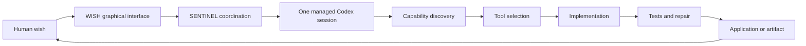

# WISH Android — Autonomous Engineering

**The human imagines. WISH prepares the environment. Codex builds and tests. The human receives the result.**

WISH aims to turn compatible Android ARM64 phones into software engineering laboratories. A person describes a result in Romanian or English; the engineering executor discovers available capabilities, selects tools, implements, tests, repairs and delivers software through a graphical interface.

WISH is a **public engineering project**. Its architecture, development and verified technical progress are shared openly. Device credentials, account state and private runtime data remain excluded.

**Current stage: M1 architecture and portable contracts. No distributable WISH APK or automatic Android installer exists in this repository.** A working Vivo laboratory is the reference implementation; its verified behavior does not establish that a new Android package can reproduce it.

## What is here

| Implemented in this repository | Verified only in the Vivo reference | Planned |
| --- | --- | --- |
| Evidence-aware registry validation and bilingual selection hints | Existing SENTINEL-managed Codex and wish workflow | Kotlin/Compose Android application |
| Job transition and artifact integrity contracts | Conda environment execution, Python and native tools | Supported Linux provisioning and signed updates |
| Resource-budget planning without installation | Romanian browser Hub and project/application controls | Account onboarding and portable runtime adapters |
| Dependency-free unit tests and repository privacy checks | Mathematical simulation, browser export and physical pinch gestures | Clean-device APK installation and cross-device support |

Reference evidence is curated in [evidence/vivo-reference.json](evidence/vivo-reference.json). It contains no credentials, session identifiers, runtime state or raw device logs.

## Engineering model



AI model access uses the user's own supported Codex authentication and account entitlement. WISH does not include an account, model subscription, credentials or an offline large language model. GitHub connectivity is optional for local engineering.

## Development on Windows / Ryzen

Primary workstation target: Windows on an AMD Ryzen PC, PowerShell 7. Phone target: Android ARM64; Windows x64 binaries are not Android ARM64 binaries. The workstation has not been inspected or tested during M1.

With Python 3.12+ already installed:

```powershell
./scripts/Test-Repository.ps1
```

Equivalent portable checks:

```text
python -B -m unittest discover -s tests -v
python -B scripts/check_repository.py
```

These checks require no Android SDK, new Codex session, API key, installation or external model request. CI is configured for Windows and Linux; a configured workflow is not a completed CI run.

## Start reading

- [Product vision](PRODUCT-VISION.md), [architecture](ARCHITECTURE.md), [Android installation design](ANDROID-INSTALLATION-DESIGN.md)
- [Codex](CODEX-INTEGRATION.md), [SENTINEL](SENTINEL-INTEGRATION.md), [capability registry](SOFTWARE-CAPABILITY-REGISTRY.md)
- [Hardware compatibility](HARDWARE-COMPATIBILITY.md), [testing](TESTING-STRATEGY.md), [M1–M10 roadmap](DEVELOPMENT-ROADMAP.md)
- [Reusable Vivo components](docs/VIVO-REFERENCE.md), [Windows setup](docs/WINDOWS-DEVELOPMENT.md), [security and boundaries](docs/SECURITY.md)
- [Source references](docs/SOURCES.md), [initial delivery status](docs/M1-REPORT.md)

The first feasibility gate is Android's native execution policy. PRoot simulates a userspace root view; it does not grant Android root or remove app sandbox restrictions. The initial prototype should investigate an explicit Termux companion integration before claiming an independent one-APK Linux installer.
